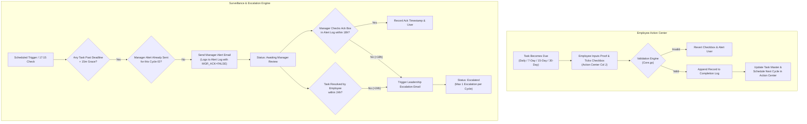

# Allo Innoware — Recurring Task Tracking, Pending Reports & Escalation Automation

**Candidate:** Recent B.Tech Computer Science Graduate (AI/ML Focus)  
**Role Target:** AI Operations Manager / Operations Automation Specialist  
**Submission Contact:** `hr.ops.allo@gmail.com`  
**Technology Stack:** Google Sheets, Google Apps Script, Spreadsheet Formulas, Gmail Service (`MailApp`)

---

## 1. Executive Summary & Architecture

This project is a production-grade operational workflow prototype designed for Allo Innoware to track recurring operational tasks, capture single-point employee submissions with audit trails, detect overdue tasks, and manage manager alerts and leadership escalations.

Built on **Google Sheets** (user interface and relational data store) and **Google Apps Script** (automation engine), the system eliminates manual calculation of due dates, prevents schedule drift, provides a single operating location for operations staff, and enforces a strict SLA with anti-spam deduplication.

### End-to-End Workflow

---

## 2. Workbook Structure (6 Sheets)

The workbook adheres to relational database principles with clear separation of concerns:

| Sheet Name | Purpose | Key Columns / Features |
|---|---|---|
| **`Task Master`** | Master catalog & recurring state tracker | Task ID (`TASK-001`), Task Name, Assigned Employee, Email, Frequency Type, Frequency Days, Proof Type, Due Time, Current Due Date, Current Cycle ID, Task Active, Last Done By/At, Status, Next Due Date. |
| **`Action Center`** | Primary employee operating interface | Cycle ID, Task ID, Task Name, Employee, Due Date, Due Time, Status, Required Proof, Ticket ID, Daily Confirmation (Checkbox), Completion Notes, Evidence Link, Completed By/At, Manager Review Status. |
| **`Completion Log`** | Append-only immutable audit trail | Record ID (`COMP-XXX`), Cycle ID, Task ID, Task Name, Employee, Completed By, Timestamp, Ticket ID, Daily Confirmation, Notes, Evidence Link, Validation Result. |
| **`Manager Dashboard`** | Consolidated executive visibility | High-level KPI summary cards (Total Active, Due Today, Overdue, Completed, Unacknowledged Alerts, Escalated) and live `QUERY` view pulling active task statuses. |
| **`Alert & Escalation Log`** | Notification history & manager acknowledgement | Event ID (`ALERT-XXX`), Cycle ID, Task ID, Employee, Event Type, Timestamp, Recipient, Subject, Status, Manager Acknowledged (Checkbox), Ack By, Ack At, Escalation Status, Notes. |
| **`Settings`** | Dynamic configuration table | Manager Email, Leadership Email, Project Time Zone, Working Days, Daily Deadline, Manager Alert Delay, Manager Ack Window, Employee Resolution Window, Test Mode, Email Enabled, Test Recipient. |

---

## 3. Recurring Task Engine & Scheduling Policies

To guarantee consistency across cycles, the recurrence engine applies four explicit mathematical rules:

1. **Cadence Preservation (Anti-Drift):**
   For interval tasks (7, 15, 30 days):
   $$\text{Next Due Date} = \text{Current Cycle Due Date} + \text{Frequency in Days}$$
   *Example:* If a 7-day task due on Friday is completed late on Monday, the next cycle is scheduled for the following Friday (not Monday), maintaining regular business cadence.
2. **Working Day Aware (Daily Tasks):**
   Daily tasks advance to the next working day based on the configured `Working Days` setting (`Mon,Tue,Wed,Thu,Fri`). Completions submitted on Friday automatically schedule the next cycle for Monday.
3. **Catch-up Rule for Lapsed Cycles:**
   If a task is completed so late that $\text{Current Due Date} + \text{Frequency} < \text{Today}$, the engine advances forward in intervals until $\text{Next Due Date} \ge \text{Today}$. This prevents backlog storms of obsolete historical cycles.
4. **Idempotency & Deduplication:**
   Every cycle is assigned a deterministic ID: `TASK-XXX-C001`, `TASK-XXX-C002`. The script validates that no duplicate cycle exists in `Action Center` before generation.

---

## 4. Daily Task Completion Method (The WhatsApp Problem)

### The Operational Challenge
Daily operational tasks (e.g., posting shift handover updates in a WhatsApp group) do not generate an automated ticket ID.

### The Solution: Attestation with Supervisor Auditability
- **Why not a WhatsApp bot or scraper?**
  Web scraping violates Meta Terms of Service and risks phone number bans. Setting up the Meta Cloud WhatsApp Business API requires paid servers, webhooks, and business verification—unnecessary overhead for a lightweight spreadsheet prototype.
- **The Implemented Approach:**
  1. Employee A posts the daily update in the team WhatsApp group by 17:00.
  2. Employee A opens the **Action Center**.
  3. Employee A enters a **Completion Note** confirming the update (e.g., *"Daily ops update shared in WhatsApp Ops group at 16:45"*).
  4. Employee A may optionally paste an **Evidence Link** (e.g., a Drive screenshot).
  5. Employee A checks the **Daily Confirmation** checkbox in Column J.
  6. The script verifies that notes are present, captures the authenticated user email and server timestamp, records an immutable entry in the `Completion Log`, and advances the task to the next working day.

---

## 5. Service Level Agreement (SLA) & Escalation Rules

| SLA Parameter | Value | Justification for a Small Team (3–4 Members) |
|---|---|---|
| **Daily Deadline** | 17:00 (5:00 PM) | End-of-day operational cutoff allowing end-of-shift review. |
| **Manager Alert Check** | 17:15 (15-min grace) | Provides a grace period for last-minute submissions before alerting leadership. |
| **Manager Ack Window** | 18 hours (Next day 10:00 AM) | Allows the manager until the next morning to inspect blockers and review team updates. |
| **Employee Resolution Window** | 24 hours | Standard turnaround time for an employee to resolve the bottleneck or explain the delay. |
| **Leadership Escalation Triggers** | 1. Unresolved after 24 hrs 2. Unacknowledged after 18 hrs | Ensures neglected tasks are escalated without inundating senior leadership with false alarms. |
| **Deduplication Guard** | Max 1 Alert & 1 Escalation per Cycle | Eliminates alert fatigue; checks `Alert & Escalation Log` before every email dispatch. |

---

## 6. Project Codebase Structure

The Apps Script project is modularized into 6 clean `.gs` files:

- [`Config.gs`](apps-script/Config.gs): Centralized sheet name mappings, column index definitions, status tags, timezone utilities, and dynamic settings getters/setters.
- [`Setup.gs`](apps-script/Setup.gs): Automated workbook initialization (`setupWorkbook()`), sheet generation, formula bindings, validations, and initial dummy tasks.
- [`Core.gs`](apps-script/Core.gs): Task completion engine, proof validators, immutable logging, recurrence calculations, and Task Master synchronization.
- [`Notifications.gs`](apps-script/Notifications.gs): Overdue detection, HTML email templates, anti-spam deduplication, manager acknowledgement handler, and leadership escalation engine.
- [`Triggers.gs`](apps-script/Triggers.gs): Custom spreadsheet menu (`onOpen`), installable `onEdit` event router, and time-driven background automations.
- [`Testing.gs`](apps-script/Testing.gs): Automated test orchestrator running all 8 required assignment tests with state backup/restore and automated test report generation.

---

## 7. Setup & Installation Guide

1. **Create Sheet:** Open [sheets.new](https://sheets.new) in your browser. Name it `Allo Innoware - Recurring Task & Escalation Tracker`.
2. **Open Apps Script:** Click **Extensions** > **Apps Script**.
3. **Add Files:** Copy the code from `apps-script/` into your Apps Script editor matching the file names (`Config.gs`, `Setup.gs`, `Core.gs`, `Notifications.gs`, `Triggers.gs`, `Testing.gs`).
4. **Run Initialization:** Select `setupWorkbook` from the toolbar and click **Run**. Grant standard Google permissions.
5. **Install Triggers:** In the top menu of your Google Sheet, click **Task Tracker** > **Install Automation Triggers** (or run `installTriggers` in Apps Script).
6. **Configure Settings:** Open the `Settings` tab. Set your target emails. Keep `Test Mode = TRUE` during verification.

---

## 8. Automated Test Suite (8 Test Scenarios)

To execute the test suite: Click **Task Tracker** > **Run All Tests** in your Google Sheet.

| Test ID | Scenario | Verification Focus |
|---|---|---|
| **TEST-1** | Recurring Cycle Creation | Cadence preservation (7 days out) and duplicate cycle prevention. |
| **TEST-2** | Single-Point Completion | Action Center updates Task Master and Completion Log in one single user action. |
| **TEST-3** | Daily Task Completion | Attestation note validation and next working day scheduling (skipping weekends). |
| **TEST-4** | Same-Day Manager Alert | Overdue detection past 17:15 and anti-spam deduplication. |
| **TEST-5** | Manager Acknowledgement | Capturing manager email/timestamp and updating Dashboard KPIs. |
| **TEST-6** | Leadership Escalation | Triggering escalation on expired SLA (>24h unresolved or >18h unacknowledged). |
| **TEST-7** | SLA Escalation Timing | Boundary math for 15-min grace, 18-hour ack, 24-hour resolution across working days. |
| **TEST-8** | Duplicate Prevention & Idempotency | Re-executing all triggers against existing tasks without generating duplicates. |

---

## 9. Interview Defense & Technical Discussion

### 2-Minute Elevator Pitch
> *"I built a lightweight, robust operations tracking system using Google Sheets and Apps Script for Allo Innoware. Instead of forcing employees to navigate multiple sheets or building an expensive external web app, I designed a single-point Action Center where employees submit proof once. The system automatically preserves recurrence cadence, validates ticket IDs and WhatsApp attestations, archives immutable logs, and runs background SLA surveillance. If an item is overdue, the manager is alerted, and if unacknowledged after 18 hours or unresolved after 24 hours, it escalates to leadership. I built full deduplication guards so re-running triggers never creates duplicate cycles or email spam, and included an automated 8-test validation suite."*

### Key Technical Q&A
1. **Why use an installable `onEdit` trigger instead of a simple trigger?**
   Simple triggers (`onEdit(e)`) run in an anonymous sandbox and cannot send emails or access restricted sheets. An installable trigger runs under the authorized user's permissions, enabling seamless notifications and audit writes.
2. **How did you prevent race conditions when two users submit tasks simultaneously?**
   I implemented Google Apps Script's `LockService.getScriptLock(30000)`. Any write operation acquires an exclusive script lock, guaranteeing atomicity and preventing duplicate cycle generation.
3. **Why not use pure Google Sheets formulas for the Action Center?**
   Formula outputs (`FILTER`, `QUERY`) are read-only arrays. Employees cannot enter Ticket IDs or click checkboxes in formula ranges without breaking the formula. The Action Center is therefore script-maintained.
4. **How do you handle Google Workspace email quotas?**
   I built a sandboxed `Test Mode` (`Test Mode = TRUE` in `Settings`) where alert events are logged to the sheet or routed to a test inbox without consuming daily quotas. In addition, the deduplication guard guarantees a maximum of 1 alert and 1 escalation per cycle.

---

## 10. Known Limitations & Production Enhancements

- **Time-Driven Trigger Jitter:** Google Apps Script time-driven triggers execute within a $\pm 15$ minute window of the scheduled time. Our 15-minute grace window comfortably accommodates this variance.
- **WhatsApp Direct Verification:** WhatsApp updates rely on employee attestation and supervisor review. In a larger enterprise setup, this can be integrated with the official Meta WhatsApp Business Cloud API with webhook verification.
- **Execution Timeout Limit:** Apps Script has a 6-minute execution limit. For teams with hundreds of tasks, batch array processing (`getValues()` / `setValues()`) ensures runs complete in milliseconds.
